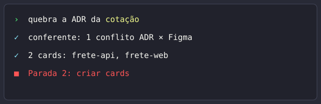

#  eeh

[Português](README.pt-BR.md)

Everyday Engineering Harness: a Claude Code plugin that turns a plain request into ADRs, Jira cards, implementation, reviews and QA, and stops for your approval before anything leaves your machine.



## How it works

The main session reads your request in natural language and splits the work among small specialist agents. Before it writes anywhere outside your machine (commit, push, PR, Jira, Confluence), it stops and shows what it is about to do. You approve, change or cancel at each stop, and questions it cannot answer go back to you.

## Phases

| Command | What it does | Example request |
| --- | --- | --- |
| `/eeh:adr` | Writes the ADR from your template, contract first. Stops on open questions and before publishing. | `/eeh:adr PROJ-7` |
| `/eeh:adr-revisar` | Handles the open comments on a published ADR. Stops before updating the page. | `/eeh:adr-revisar PROJ-7` |
| `/eeh:quebrar` | Splits an approved ADR into one Jira card per repo. Stops on conflicts and before creating cards. | `/eeh:quebrar PROJ-7` |
| `/eeh:implementar` | Implements a card in its own worktree with plan, TDD and review. Stops at the plan, the commit and the PR. | `/eeh:implementar PROJ-8` |
| `/eeh:review` | Reviews a PR with reviewers per lens and keeps only blocking items two reviewers confirm. Stops before posting. | `/eeh:review 42` |
| `/eeh:qa` | Validates a delivery in QA with the screen and the contract endpoints, and saves the evidence. Stops before moving the card. | `/eeh:qa PROJ-8` |
| `/eeh:upstream` | Compares the parts with ECC, OMC and superpowers and merges what you accept. Stops before merging. | `/eeh:upstream ecc` |

## Catalog

<!-- catalogo:inicio -->

### Commands (7)

| Name | What it does |
| --- | --- |
| `/eeh:adr` | Writes the ADR of a delivery from the profile's ADR template, contract first, reviewed by revisor-adr. |
| `/eeh:adr-revisar` | Handles the open comments of a published ADR, proposing the text change and the reply to each one. |
| `/eeh:implementar` | Implements a card end to end in its own worktree, with an approved plan, TDD, review and verification. |
| `/eeh:qa` | Validates a delivery in QA after the deploy to a develop branch, with the screen, the contract endpoints and saved evidence. |
| `/eeh:quebrar` | Splits an approved ADR into Jira cards, one per repo, with the ADR slice, contract, manual SQL and acceptance criteria. |
| `/eeh:review` | Reviews a PR, branch or diff with one reviewer per lens and returns only blocking items confirmed by two independent reviewers. |
| `/eeh:upstream` | Compares EEH pieces with ECC, OMC and superpowers, triages the new items and brings in what the author accepts. |

### Skills (24)

| Name | What it does |
| --- | --- |
| `adr` | Writes the ADR of a delivery from the profile's ADR template, contract first, reviewed by revisor-adr before publishing. |
| `adr-revisar` | Handles the open comments of an ADR published on Confluence, proposing the ADR change and the reply for each one. |
| `api-design` | Conventions for designing or reviewing REST endpoints: resource names, methods, status codes, error format, pagination, filters, auth, rate limit and versioning. |
| `debugar` | Investigates a bug, failing test, regression or build error down to the root cause before proposing a fix. |
| `deepinit` | Generates one AGENTS.md per relevant folder of a work repo, with only what the code shows and a source for every claim. |
| `entender` | Turns a vague request into a clear scope and verifiable acceptance criteria, asking one thing at a time. |
| `entregas` | Resumes a delivery by its card key, or shows the overview of deliveries in progress. |
| `error-handling` | Error handling patterns in Go and TypeScript: typed errors, wrapping with context, status code mapping, retry with backoff and error boundaries. |
| `explorar` | Understands how a part of the code works before changing it, and looks for an existing solution before writing new code. |
| `git` | Operates git safely: one worktree per card, atomic commits, Conventional Commits messages, safe rebase and closing the branch. |
| `inherit-legacy-style` | Collects the implicit conventions of hand-written legacy code, settles conflicts with the author and writes an .ai-style-rules.md. |
| `limpar` | Cleans code that works but is bloated, repeated or has useless layers, without changing behavior. |
| `manutencao-pacote` | Turns a flow that just happened into a new skill or agent, adjusts an existing piece, lists unused pieces and overlapping descriptions. |
| `planejar` | Turns an understood scope into an implementation plan of small testable tasks, with a separate critique before approval. |
| `postgres-patterns` | PostgreSQL quick reference for indexes, data types, slow queries, pagination, SKIP LOCKED queues and configuration. |
| `qa` | Validates a delivery in QA after the deploy to a develop branch, with the screen, the contract endpoints and saved evidence. |
| `qa-pos-deploy` | Checks a URL after a QA or production deploy with a browser automation MCP: smoke test, interaction, visual regression, accessibility and endpoints. |
| `quebrar` | Splits an approved ADR into Jira cards, one per repo, each with the ADR slice, contract, manual SQL and acceptance criteria. |
| `redis-patterns` | Redis patterns for cache, distributed locks, rate limit, sessions, pub/sub and streams, with key design, TTL and eviction. |
| `review` | Reviews a PR or diff for blocking items, asks an independent reviewer for review, and handles received feedback with verification. |
| `sql-manual` | Writes or reviews a SQL script run by hand in a change window, with database, environment, order, rollback and idempotency spelled out. |
| `strategic-compact` | Decides when to run /compact in a long session, at a phase boundary, and what to save to a file first. |
| `testar` | Writes tests first (TDD), defines the test strategy, fixes flaky tests and checks whether a PR's tests cover the changed behavior. |
| `verificar` | Checks with fresh evidence that a change meets the acceptance criteria before saying it is done, and before commit, push or PR. |

### Agents (35)

| Name | What it does |
| --- | --- |
| `analista-epico` | Reads an epic, the trimmed Figma and the profile repos, and returns the impact per repo. |
| `architect` | Analyzes architecture and trade-offs of a change, read-only. |
| `build-fix-go` | Fixes broken Go build, go vet and lint with the smallest possible change. |
| `build-fix-react` | Fixes broken build, TypeScript errors and lint in a React with Vite project with the smallest possible change. |
| `code-reviewer` | Reviews a diff or PR and reports only blocking items the PR introduced. |
| `conferente` | Checks the ADR against its slices, the Figma design and the code, and lists the conflicts or says "no conflict". |
| `critic` | Looks for holes in a plan, spec or ADR before implementation, read-only. |
| `debugger` | Finds the root cause of a bug: reproduces it, isolates the regression and proposes the minimal fix. |
| `document-specialist` | Finds and summarizes external and repo documentation: SDK APIs, frameworks, third-party services, READMEs and ADRs. |
| `explorar` | Searches the code and traces execution flow, read-only. |
| `extrator-contrato` | Extracts a repo's contract from the ADR: route, request, response and errors. |
| `extrator-sql` | Extracts a repo's manual SQL from the ADR: script, database, environment, order and rollback. |
| `front-visual` | Builds UI from the Figma slice and compares the result with the screen: layout, states, copy and accessibility. |
| `git` | Runs git operations: branch, status, diff, stage, history, rebase and worktree. |
| `implementador-go` | Implements a Go task following the plan and the repo pattern. |
| `implementador-react` | Implements a React and TypeScript front task following the plan and the repo pattern. |
| `leitor-comentarios` | Reads the open comments on an ADR and proposes, for each one, the ADR change and the reply. |
| `opensource-sanitizer` | Audits an EEH diff before commit for author work data that the sanitizer regex misses. |
| `planner` | Turns an approved spec or ADR into an implementation plan with small tasks, order, files and how to validate. |
| `recortador-figma` | Slices the Figma metadata into the screens of a front card: link, states and copy. |
| `redator-aceite` | Writes a card's acceptance criteria as testable steps, from the ADR and the cited business rules. |
| `redator-adr` | Writes the ADR draft in markdown from the analysis, the template and the checklist. |
| `redator-card` | Writes a card's recorte.json by joining the outputs of the extractors. |
| `redator-ptbr` | Writes Brazilian Portuguese text for other people to read: PR descriptions, Teams messages, card solutions and review comments. |
| `reviewer-database` | Reviews SQL, migrations and database access: index, lock, transaction, N+1, shared tables and rollback. |
| `reviewer-go` | Reviews Go changes: concurrency, ignored errors, goroutine leaks, injected SQL and commands, races. |
| `reviewer-react` | Reviews React changes: hooks, derived state, effects without cleanup, list keys, accessibility and render. |
| `reviewer-typescript` | Reviews TypeScript changes: any, type assertions that hide errors, unhandled promises, unchecked null and broken narrowing. |
| `revisor-adr` | Reviews the ADR draft against the template and the checklist and ranks each item as Blocking, High or Medium. |
| `security-reviewer` | Looks for vulnerabilities in a diff: authn and authz, injection, data leaks, secrets in code, SSRF and unsafe dependencies. |
| `silent-failure-hunter` | Looks for silent failures: swallowed errors, fallbacks that hide defects, empty catch, logs without context and missing rollback. |
| `test-engineer` | Designs and writes tests: strategy, coverage, PR gaps and flaky tests. |
| `tracer` | Investigates odd behavior with competing hypotheses and says which test decides between them. |
| `type-design-analyzer` | Evaluates the design of new or changed types: whether they prevent invalid states and let the compiler enforce the invariant. |
| `verifier` | Checks with evidence that the work is done: runs the verification commands and says what was and was not proven. |

<!-- catalogo:fim -->

## Install

Run the plugin from a local clone, for one session:

```bash
claude --plugin-dir ~/Code/everyday-engineering-harness
```

Or install it from the repo marketplace, inside Claude Code:

```
/plugin marketplace add ~/Code/everyday-engineering-harness
/plugin install eeh@everyday-engineering-harness
```

The profile lives outside the repo, in `~/.config/eeh/perfil.json`. Start from the example:

```bash
mkdir -p ~/.config/eeh
cp perfil.example.json ~/.config/eeh/perfil.json
```

Without the file, the plugin warns that the profile is missing and keeps going. Fields are listed in `docs/uso-local.md`. Run `npm test` before committing.

## Credits

eeh adapts ideas and parts from [Everything Claude Code](https://github.com/affaan-m/everything-claude-code) (ECC), [oh-my-claudecode](https://github.com/Yeachan-Heo/oh-my-claudecode) (OMC) and [superpowers](https://github.com/obra/superpowers) (obra/superpowers), all MIT. See `NOTICE.md` and `upstream.json` for the source of each part. The colors come from the Dracula palette (MIT, Zeno Rocha).

## License

MIT. See `LICENSE`.
