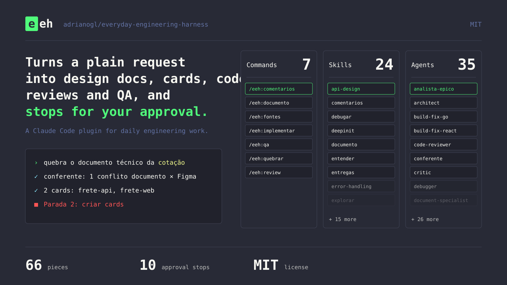

#  eeh

[English](README.md)

Everyday Engineering Harness é um plugin do Claude Code para o trabalho diário de engenharia. Ele transforma um pedido em linguagem natural em ADR, cards do Jira, implementação, review e QA, e para para a sua aprovação antes de qualquer coisa sair da sua máquina.



## Como funciona

A sessão principal lê o seu pedido e divide o trabalho entre agents especialistas pequenos. Antes de escrever fora da sua máquina (commit, push, PR, Jira, Confluence), ela para e mostra o que vai fazer. Você aprova, muda ou cancela em cada parada, e a dúvida que ela não resolve volta para você.

## Fases

| Command | O que faz | Exemplo de pedido |
| --- | --- | --- |
| `/eeh:adr` | Escreve a ADR a partir do seu template, contrato primeiro. Para nas dúvidas e antes de publicar. | `/eeh:adr PROJ-7` |
| `/eeh:adr-revisar` | Trata os comentários abertos de uma ADR publicada. Para antes de atualizar a página. | `/eeh:adr-revisar PROJ-7` |
| `/eeh:quebrar` | Quebra uma ADR aprovada em um card do Jira por repo. Para nos conflitos e antes de criar os cards. | `/eeh:quebrar PROJ-7` |
| `/eeh:implementar` | Implementa um card num worktree próprio, com plano, TDD e review. Para no plano, no commit e na PR. | `/eeh:implementar PROJ-8` |
| `/eeh:review` | Revisa uma PR com reviewers por lente e traz só item bloqueante confirmado por dois. Para antes de postar. | `/eeh:review 42` |
| `/eeh:qa` | Valida a entrega em QA com a tela e os endpoints do contrato, e guarda a evidência. Para antes de mover o card. | `/eeh:qa PROJ-8` |
| `/eeh:upstream` | Compara as peças com ECC, OMC e superpowers e incorpora o que você aceitar. Para antes de incorporar. | `/eeh:upstream ecc` |

## Catálogo

<!-- catalogo:inicio -->

### Commands (7)

| Nome | O que faz |
| --- | --- |
| `/eeh:adr` | Escreve a ADR de uma entrega a partir do template de ADR do perfil, com contrato primeiro e revisão do revisor-adr. |
| `/eeh:adr-revisar` | Trata os comentários abertos de uma ADR publicada, propondo a mudança no texto e a resposta de cada comentário. |
| `/eeh:implementar` | Implementa um card de ponta a ponta num worktree próprio, com plano aprovado, TDD, review e verificação. |
| `/eeh:qa` | Valida uma entrega em QA depois do deploy numa develop, com tela, endpoints do contrato e evidência guardada. |
| `/eeh:quebrar` | Quebra uma ADR aprovada em cards do Jira, um por repo, com recorte da ADR, contrato, SQL manual e critério de aceite. |
| `/eeh:review` | Revisa PR, branch ou diff com reviewers por lente e devolve só item bloqueante confirmado por dois reviewers. |
| `/eeh:upstream` | Compara as peças do EEH com ECC, OMC e superpowers, sugere a triagem dos itens novos e incorpora o que você aceitar. |

### Skills (24)

| Nome | O que faz |
| --- | --- |
| `adr` | Escreve a ADR de uma entrega a partir do template do perfil, contrato primeiro, com revisão do revisor-adr. |
| `adr-revisar` | Trata os comentários abertos de uma ADR publicada no Confluence: a mudança no texto e a resposta de cada um. |
| `api-design` | Convenções para desenhar ou revisar endpoints REST: recursos, métodos, status codes, erro, paginação e versionamento. |
| `debugar` | Investiga bug, teste que falha, regressão ou erro de build até achar a causa raiz, antes de propor correção. |
| `deepinit` | Gera um AGENTS.md por pasta relevante de um repo, só com o que o código mostra e a fonte de cada afirmação. |
| `entender` | Transforma pedido vago em escopo claro e critérios de aceite verificáveis, perguntando uma coisa por vez. |
| `entregas` | Retoma uma entrega pela chave do card ou mostra o panorama das entregas em andamento. |
| `error-handling` | Padrões de erro em Go e TypeScript: erros tipados, wrapping, status code, retry com backoff e error boundary. |
| `explorar` | Entende como uma parte do código funciona antes de mexer e procura solução existente antes de escrever código novo. |
| `git` | Opera git com segurança: worktree por card, commits atômicos, Conventional Commits, rebase seguro e fim da branch. |
| `inherit-legacy-style` | Levanta as convenções implícitas de um código legado e grava um .ai-style-rules.md aplicável. |
| `limpar` | Limpa código que funciona mas ficou inchado, repetido ou com camadas inúteis, sem mudar comportamento. |
| `manutencao-pacote` | Transforma um fluxo repetido em skill ou agent, ajusta peças existentes e lista peças sem uso ou sobrepostas. |
| `planejar` | Transforma um escopo entendido em plano de tarefas pequenas e testáveis, com crítica separada antes da aprovação. |
| `postgres-patterns` | Referência rápida de PostgreSQL: índices, tipos, queries lentas, paginação, fila com SKIP LOCKED. |
| `qa` | Valida uma entrega em QA depois do deploy numa develop, com tela, endpoints do contrato e evidência guardada. |
| `qa-pos-deploy` | Verifica uma URL depois do deploy com um MCP de browser: smoke test, interação, regressão visual e acessibilidade. |
| `quebrar` | Quebra uma ADR aprovada em cards do Jira, um por repo, com recorte, contrato, SQL manual e critério de aceite. |
| `redis-patterns` | Padrões de Redis para cache, lock distribuído, rate limit, sessão, pub/sub e streams, com chave e TTL. |
| `review` | Revisa PR ou diff por item bloqueante, pede review independente e trata o feedback recebido com verificação. |
| `sql-manual` | Escreve ou revisa SQL rodado à mão na GMUD, com banco, ambiente, ordem, rollback e idempotência explícitos. |
| `strategic-compact` | Decide quando rodar /compact numa sessão longa, na fronteira de fase, e o que salvar em arquivo antes. |
| `testar` | Escreve testes primeiro (TDD), define a estratégia, corrige teste flaky e confere se os testes da PR cobrem a mudança. |
| `verificar` | Confere com evidência nova que a mudança cumpre os critérios de aceite antes de dizer que está pronta. |

### Agents (35)

| Nome | O que faz |
| --- | --- |
| `analista-epico` | Lê um épico, o Figma recortado e os repos do perfil e devolve o impacto por repo. |
| `architect` | Analisa arquitetura e trade-offs de uma mudança, só leitura. |
| `build-fix-go` | Corrige build, go vet e lint quebrados em Go com a menor mudança possível. |
| `build-fix-react` | Corrige build, erro de TypeScript e lint quebrados em projeto React com Vite com a menor mudança possível. |
| `code-reviewer` | Faz review geral de diff ou PR seguindo o code-review.md do autor: só item bloqueante, só o que a PR introduziu. |
| `conferente` | Confere a ADR contra os recortes, o Figma e o código e devolve os conflitos, ou 'sem conflito'. |
| `critic` | Critica um plano, spec ou ADR procurando furo antes da implementação, só leitura. |
| `debugger` | Acha a causa raiz de um bug: reproduz, isola a regressão, lê stack trace e propõe a correção mínima. |
| `document-specialist` | Busca e resume documentação externa e do repo: API de SDK, framework, serviço de terceiro, README e ADR. |
| `explorar` | Busca no código e rastreia fluxo de execução, só leitura. |
| `extrator-contrato` | Extrai da ADR o contrato de um repo: rota, request, response e erros. |
| `extrator-sql` | Extrai da ADR o SQL manual de um repo e devolve o objeto sql do Recorte: script, banco, ambiente, ordem e rollback. |
| `front-visual` | Constrói UI a partir do recorte do Figma e compara o resultado com a tela: layout, estados, copy e acessibilidade. |
| `git` | Executa operações de git: branch, status, diff, stage, histórico, rebase e worktree, seguindo rules/git.md. |
| `implementador-go` | Implementa uma tarefa em Go (service, handler, repositório, migration, teste) seguindo o plano e o padrão do repo. |
| `implementador-react` | Implementa tarefa de front em React e TypeScript seguindo o plano e o padrão do repo. |
| `leitor-comentarios` | Lê os comentários abertos de uma ADR e, para cada um, propõe a mudança na ADR e a resposta ao comentário. |
| `opensource-sanitizer` | Audita um diff do EEH antes do commit e aponta dado do trabalho do autor que o regex do sanitizer não pega. |
| `planner` | Transforma uma spec ou ADR aprovada em plano de implementação com tarefas pequenas, ordem, arquivos e como validar. |
| `recortador-figma` | Recorta dos metadados do Figma as telas de um card de front e devolve o objeto figma do Recorte: link, estados e copy. |
| `redator-aceite` | Escreve o critério de aceite de um card em passos testáveis, a partir da ADR e das regras de negócio citadas. |
| `redator-adr` | Escreve o rascunho da ADR em markdown a partir da análise, do template e do checklist. |
| `redator-card` | Escreve o recorte.json de um card no formato Recorte, juntando as saídas dos extratores. |
| `redator-ptbr` | Escreve em português do Brasil PR, GMUD, mensagem do Teams, solução técnica de card, ADR e comentário de review. |
| `reviewer-database` | Revisa SQL, migrations e acesso a banco: índice, lock, transação, N+1, tabela compartilhada e rollback. |
| `reviewer-go` | Revisa mudanças em Go: concorrência, erro ignorado, vazamento de goroutine, SQL montado com input e race. |
| `reviewer-react` | Revisa mudanças em React: hooks, estado derivado, efeito sem limpeza, chave de lista, acessibilidade e render. |
| `reviewer-typescript` | Revisa mudanças em TypeScript: any, asserção que esconde erro, promise sem tratamento, null não checado. |
| `revisor-adr` | Revisa o rascunho da ADR contra o template e o checklist e classifica cada item em Bloqueante, Alta ou Média. |
| `security-reviewer` | Procura vulnerabilidade no diff: authn e authz, injeção, vazamento de dado, segredo no código e SSRF. |
| `silent-failure-hunter` | Procura falha silenciosa: erro engolido, fallback que esconde defeito, catch vazio, log sem contexto e rollback ausente. |
| `test-engineer` | Desenha e escreve testes: estratégia, cobertura, lacunas de uma PR, testes flaky. |
| `tracer` | Investiga comportamento estranho com hipóteses concorrentes e diz qual teste decide entre elas. |
| `type-design-analyzer` | Avalia tipos novos ou alterados: se impedem estado inválido e se o compilador impõe a invariante. |
| `verifier` | Confere com evidência se o trabalho está pronto: roda a verificação e diz o que foi e o que não foi provado. |

<!-- catalogo:fim -->

## Instalação

Clone o repo:

```bash
git clone https://github.com/adrianogl/everyday-engineering-harness ~/Code/everyday-engineering-harness
```

Rode o plugin do clone, só para uma sessão:

```bash
claude --plugin-dir ~/Code/everyday-engineering-harness
```

Ou instale pelo marketplace do repo, dentro do Claude Code:

```
/plugin marketplace add ~/Code/everyday-engineering-harness
/plugin install eeh@everyday-engineering-harness
```

O perfil fica fora do repo, em `~/.config/eeh/perfil.json`. Comece copiando o exemplo:

```bash
mkdir -p ~/.config/eeh
cp perfil.example.json ~/.config/eeh/perfil.json
```

Sem o arquivo, o plugin avisa que o perfil está ausente e segue sem ele. Os campos estão em `docs/uso-local.md`.

## Contribuindo

Rode `npm test` antes de commitar.

## Créditos

O eeh adapta ideias e peças do [Everything Claude Code](https://github.com/affaan-m/everything-claude-code) (ECC), do [oh-my-claudecode](https://github.com/Yeachan-Heo/oh-my-claudecode) (OMC) e do [superpowers](https://github.com/obra/superpowers) (obra/superpowers), todos MIT. `NOTICE.md` e `upstream.json` dizem de onde vem cada peça. As cores vêm da paleta [Dracula](https://draculatheme.com) (MIT, Zeno Rocha).

## Licença

MIT. Veja `LICENSE`.
